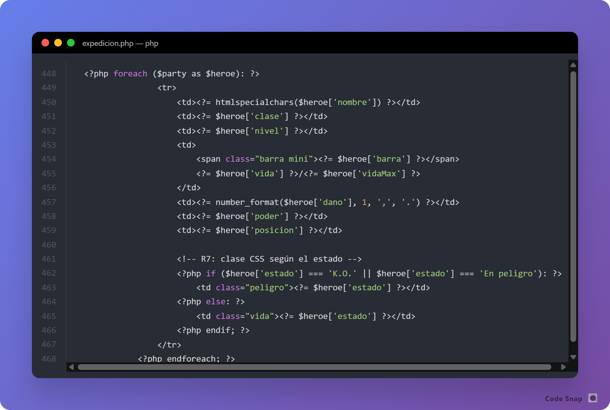
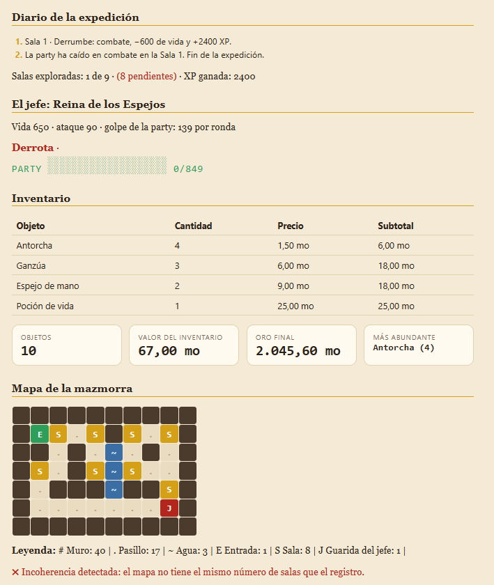

# Memoria · Tarea de refuerzo UD3 «Forja de Héroes II»

**Alumno/a:** Marina Rodriguez Blázquez · **Variante:** C · **Fecha:** 30/10/2026

> Esta tarea *lleva nota**: sirve para comprobar que dominas lo que necesitarás en la UD5 (sesiones y login) y para preparar la prueba de diagnóstico del RA 3. Las capturas van en `capturas/` y se enlazan así: ``

## 1. Comprobación de resultados

Compara TU página con la tabla de comprobación del enunciado.

| Dato | Valor esperado (enunciado) | Valor de mi página | ¿Coincide? |
|---|---|---|---|
| Poder total de la party | 1414 · 6,5 | 1414 · 6,5 | Sí |
| Daño por ronda | 138,8 | 138,8 | Sí |
| Líder | Vex | Vex| Sí |
| Vida al salir de las salas | 375 | | |
| Resultado frente al jefe (y ronda) | Victoria en ronda 5 | Victoria en ronda 5 | Sí |
| Oro final | 2720,60 | 2720,60 | Sí |
| Valor del inventario | 287 | 287 | Sí |
| Salas en el mapa | 8 | 8 | Sí |

Si algo no coincide, explica qué estaba mal y cómo lo arreglaste.

Lo principal que me di cuenta es que al hacer el experimento no se actualizaba bien (aparecía la vida en negativo). Este fue un error donde no puse bien el cierre del switch, de manera que el if que determinaba si la party continuaba o no, no se estaba ejecutando. Se solucionó simplemente poniendo el cierre donde correspondía.

## 2. Bucles y documento resultante

- Captura del `foreach` que pinta la tabla de la party en tu editor y del **Ctrl+U** de esa tabla.


- En el código hay **una** fila `<tr>`; en el Ctrl+U, ¿cuántas? ¿Por qué?
En el Ctrl +U hay 4 porque es el buble del código desplegado (con todos los objetos del array en él y no simplificado).
- ¿Aparece en el Ctrl+U algo de `endforeach` o de `if`? ¿Por qué?

No, no aparece. Supongo que es porque ahí solo aparece cada caso desarrollado, exactamente como se muestra en el navegador, lo cual hace que no contenga la lógica que lo respalda. Por decrilo de otra forma, es lo que el navegador recibe en html/css, pero no se llega a ver el PHP.

## 3. Experimento: predigo el efecto de un cambio

Añade esta sala **al principio** de `$salas` en tu fichero de datos:

```php
['nombre' => 'Derrumbe', 'tipo' => 'combate', 'valor' => 2400],
```

1. **Predicción** (antes de recargar): ¿cuántas salas se explorarán? ¿Qué resultado tendrá el jefe? ¿Qué dirá el aviso del mapa?
    No explorarían porque la party moriría en esa primera sala. Aunque sobrevivieran, no vencerían al jefe (el resultado inicial es bastante ajustado). El mapa daría error porque no se corresponden las salas con el mapeado planteado.
2. **Resultado** real (captura).
    
3. ¿Qué sentencia ha cortado el recorrido? ¿Qué pasa con la tabla de rondas y por qué?
    Ha terminado el recorrido esa sala al ser combate, pues la vida quedaba en números negativos, de manera que el if hace que termine la expedición.
4. Deja los datos como estaban.

## 4. Experimento: match frente a switch

1. Cambia la clase de un héroe a `'Bardo'` y recarga. Captura del error. ¿Qué tipo de error es y por qué se produce?
    Es un error fatal que ocurre porque en ningún caso, en el match hay coincidencia con el bardo.
    
2. ¿Qué posición le asigna el `switch` a ese Bardo? ¿Por qué el `switch` no falla y el `match` sí?
     El switch le asignaría la posición de reserva porque es la posición por defecto cuando no hay correspondencia previa. Se podría decir que el Switch sí tiene un caso aplicado para cuando no hay coincidencias (un estado por defecto) mientras que el match no.
3. Deja los datos como estaban. ¿Qué comportamiento prefieres en un programa real y por qué?
Diría que depende. Por una parte el switch permite que el programa pueda continuar, incluso si hay un error, no obstante el match al provocar que haya un error tan visible, permite que se pueda localizar antes.

## 5. Experimento: continue dentro de switch

1. En el caso `'vacía'`, cambia `continue 2;` por `continue;` y recarga. ¿Qué aviso aparece?
Me aparece un aviso en la parte superior: 
Warning: "continue" targeting switch is equivalent to "break". Did you mean to use "continue 2"? in /var/www/html/forja-heroes-ii/src/expedicion.php on line 221.
2. ¿Qué cambia en el diario o en el recuento de salas? Explica a qué bucle afecta cada versión.
A nivel visual en la ficha, de diario o recuento de salas, no pasa nada. El continue 1 lo que hace es funcionar como un break, continuando en el foreach, mientras que el continue 2 fuerza el cierre del foreach actual para retomar el siguiente ciclo. En este caso, como la sala vacía no hace nada, no ocurre nada.
3. Déjalo como estaba.

## 6. Uso de IA (obligatorio declararlo)

¿Has usado alguna IA? ¿Para qué? Copia una respuesta que te diera y explica si era correcta o qué tuviste que corregir.
He utilizado la IA para aclaración de dudas y corrección del código (por ejemplo que no compilase por un ; o por escribir mal una variable.) Uno de los usos que para la que lo he usado es para conocer la direfencia entre el continue 1 y el 2 en el switch, para lo cual me ha dado una explicación correcta, pues plantea un aprovechamiento de recursos al forzar a que sea otro ciclo en lugar de simplemente salir del switch:

"No, no hace falta usar continue 2 en todos los casos, y de hecho hacerlo causaría un fallo importante:

        1. El flujo natural del bucle
En los demás casos (trampa, combate, tesoro, descanso), cuando se ejecuta un break; dentro del case:

El break; solo sale del switch.

Al salir del switch, PHP pasa a evaluar el código que está justo debajo: el if ($vidaParty <= 0) del TODO 4.3.

Como esa es la última línea dentro del bucle, el foreach avanza automáticamente a la siguiente sala. La ejecución no se atasca; avanza de forma natural de sala en sala.

    2. Por qué no se puede poner continue 2 en el resto
Si pusieras continue 2; en un combate o en una trampa:

PHP saltaría directamente a la siguiente sala saltándose el TODO 4.3.

Si en ese combate la party perdía toda su vida y quedaba a -20, nunca se enteraría, no anotaría la caída en el diario ni detendría el viaje con el break de la muerte.

    3. ¿Por qué en vacía sí se usa?
En la sala vacía:

No hay daño, por lo que es imposible que la party muera en ella.

No hay nada que comprobar después."
